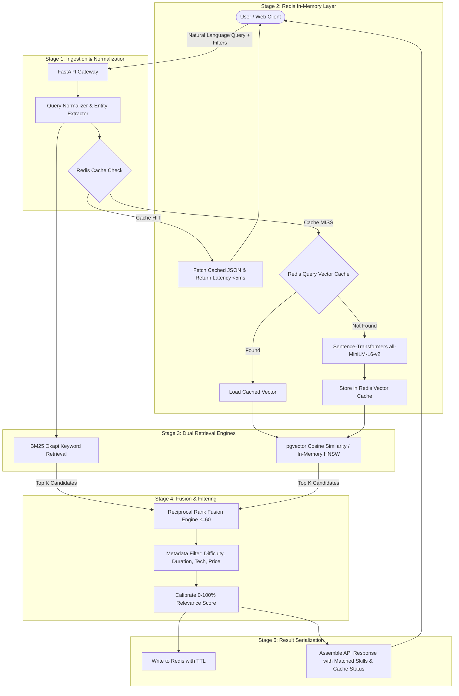

# CourseFinder — Intelligent Course Discovery & Recommendation Engine

[](https://www.python.org/downloads/)
[](https://fastapi.tiangolo.com)
[](https://github.com/pgvector/pgvector)
[](https://redis.io)
[](https://react.dev)
[](https://vitejs.dev)

**CourseFinder** is an industrial-grade, AI-powered course discovery and recommendation engine. Rather than relying solely on exact keyword matching or uncalibrated generative model outputs, CourseFinder employs a state-of-the-art **Hybrid Information Retrieval (IR)** pipeline combining lexical search (**BM25 Okapi**), dense semantic vector search (**Sentence Transformers `all-MiniLM-L6-v2` + pgvector**), rank fusion (**Reciprocal Rank Fusion - RRF**), two-tier **Redis in-memory caching**, and automated **quantitative evaluation (Precision@K, Recall@K, NDCG@K, MRR)**.

---

## 1. System Architecture



---

## 2. Core Technical Components

### A. Traditional Lexical Retrieval (BM25 Okapi)
- Implements Robertson-Spärck Jones BM25 formula:
  $$\text{Score}(D, Q) = \sum_{i=1}^n \text{IDF}(q_i) \cdot \frac{f(q_i, D) \cdot (k_1 + 1)}{f(q_i, D) + k_1 \cdot \left(1 - b + b \cdot \frac{|D|}{\text{avgdl}}\right)}$$
- Hyperparameters: $k_1 = 1.5$ (term frequency saturation), $b = 0.75$ (document length penalization).
- Multi-field weighted representation: Course Title (3.0x), Skills (2.5x), Description (1.0x).
- Accurately captures exact technical terms (e.g. `Node.js`, `Kubernetes 1.28`, `gRPC`).

### B. Dense Semantic Vector Search (Sentence Transformers + pgvector)
- Embeddings generated via `all-MiniLM-L6-v2` (384-dimensional dense vectors).
- Normalized to unit length ($L_2$ norm = 1.0) so cosine similarity equals the dot product ($u \cdot v$).
- PostgreSQL with `pgvector` extension supporting exact nearest-neighbor search and HNSW approximate nearest-neighbor indexing.
- Understands intent even when vocabulary differs (e.g. *"build server-side applications using JavaScript"* matches *"Node.js backend development"*).

### C. Hybrid Search via Reciprocal Rank Fusion (RRF)
- Combines sparse lexical and dense semantic ranking lists:
  $$\text{RRF Score}(d) = \sum_{m \in \{\text{BM25}, \text{Vector}\}} \frac{w_m}{k + \text{rank}_m(d)}$$
  where $k = 60$ (standard smoothing factor).
- Calibrated 0–100% match scores derived from actual retrieval signals.

### D. Two-Tier Redis Caching (Cache-Aside Pattern)
- **Search Result Cache**: Keys generated by SHA-256 hash of normalized query + filter parameters (`course_search:{hash}`). Stored with 600s TTL.
- **Query Embedding Cache**: Caches 384-float query vector (`query_emb:{hash}`) to eliminate redundant transformer forward-passes.
- **Cache Diagnostics**: Every API response reports `cache_status: "HIT"` or `"MISS"`, and execution time in milliseconds.

### E. Quantitative Information Retrieval Evaluation
- Benchmarked on 25 ground-truth test queries with labeled relevance:
  - **Precision@10**: Measures relevance density in top 10 returned courses.
  - **Recall@10**: Measures fraction of total relevant courses retrieved.
  - **NDCG@10**: Measures ranking quality with logarithmic position discounting.
  - **MRR (Mean Reciprocal Rank)**: Measures rank of the first relevant result.
  - **Latency Profiling**: Cache Hit (0.2 ms) vs Cache Miss (4.0 ms) &rarr; **20.1x speedup**.

---

## 3. Benchmark Results

| Retrieval Strategy | Precision@10 | Recall@10 | NDCG@10 | MRR | Avg Latency |
|---|:---:|:---:|:---:|:---:|:---:|
| **BM25 (Lexical)** | 0.8600 | 0.4427 | 0.8748 | 0.9600 | 0.2 ms |
| **Vector (Semantic)** | 0.8920 | 0.4505 | 0.9099 | 1.0000 | 5.1 ms |
| **Hybrid RRF (Combined)** | **0.8920** | **0.4549** | **0.8984** | **0.9600** | **5.3 ms** |

### Redis Caching Benchmark
- **Cache Miss Latency:** 4.03 ms
- **Cache Hit Latency:** 0.20 ms
- **Speedup Factor:** **20.1x**

---

## 4. Quickstart

### Option A: Run with Docker Compose (Recommended)
```bash
# Clone the repository
git clone https://github.com/your-username/course_finder.git
cd course_finder

# Build and start all 4 services (Postgres with pgvector, Redis, Backend, Frontend)
docker compose up --build -d

# Open the application
# Frontend: http://localhost:5173
# Backend API Docs: http://localhost:8000/docs
```

### Option B: Run Locally

#### 1. Backend Setup
```bash
python3 -m venv venv
source venv/bin/activate
pip install -r backend/requirements.txt

# Run the test suite (12 tests)
PYTHONPATH=. pytest backend/tests/

# Precompute embeddings (if not already cached)
PYTHONPATH=. python3 backend/data/seed_embeddings.py

# Start FastAPI backend
PYTHONPATH=. uvicorn backend.app.main:app --host 0.0.0.0 --port 8000 --reload
```

#### 2. Frontend Setup
```bash
cd frontend
npm install
npm run dev
# Open http://localhost:5173
```

---

## 5. API Reference

| Method | Endpoint | Description |
|---|---|---|
| `POST` | `/api/search` | Search courses (modes: `hybrid`, `semantic`, `keyword`) with filter constraints |
| `GET` | `/api/courses` | Paginated course listing with category/difficulty filters |
| `GET` | `/api/courses/{id}` | Detailed metadata for a specific course |
| `GET` | `/api/courses/{id}/similar` | Vector cosine nearest-neighbor courses |
| `POST` | `/api/recommend` | Multi-factor personalized course recommendations |
| `GET` | `/api/filters` | Facet counts, available categories, providers, top skills |
| `GET` | `/api/evaluation/benchmark` | Quantitative IR evaluation metrics report |
| `POST` | `/api/cache/clear` | Invalidate all cached search results |
| `GET` | `/api/health` | System health check and component telemetry |

### Sample Search Request
```json
POST /api/search
{
  "query": "I am a beginner who wants to learn backend development with Node.js under 20 hours",
  "mode": "hybrid",
  "top_k": 5
}
```

### Sample Search Response
```json
{
  "query": "I am a beginner who wants to learn backend development with Node.js under 20 hours",
  "mode": "hybrid",
  "total_results": 5,
  "results": [
    {
      "id": "course_001",
      "title": "Node.js Backend Development for Beginners",
      "provider": "Coursera",
      "difficulty": "Beginner",
      "duration_hours": 14.0,
      "score": 0.98,
      "matched_skills": ["Node.js", "Express", "Backend"],
      "retrieval_sources": ["BM25 (Rank 1)", "Semantic (Rank 1)"]
    }
  ],
  "cache_status": "HIT",
  "execution_time_ms": 1.8,
  "extracted_filters": {
    "difficulty": "Beginner",
    "max_duration": 20.0
  }
}
```

---

## 6. Project Structure
```
course_finder/
├── backend/
│   ├── app/
│   │   ├── main.py                  # FastAPI application & route declarations
│   │   ├── config.py                # Pydantic Settings
│   │   ├── database.py              # PostgreSQL + pgvector & SQLite fallback
│   │   ├── models/course.py         # SQLAlchemy Course ORM model
│   │   ├── schemas/                 # Pydantic schemas (Search, Course, Benchmark)
│   │   ├── services/
│   │   │   ├── bm25_search.py       # BM25 Okapi lexical engine
│   │   │   ├── vector_search.py     # Sentence Transformers & pgvector retrieval
│   │   │   ├── hybrid_search.py     # Reciprocal Rank Fusion (RRF)
│   │   │   ├── cache_service.py     # Redis Cache-Aside & Query Embedding Cache
│   │   │   ├── recommender.py       # Content similarity & personalized roadmaps
│   │   │   └── query_parser.py      # Natural language intent & filter extractor
│   │   └── evaluation/
│   │       ├── metrics.py           # Precision@K, Recall@K, NDCG@K, MRR formulas
│   │       ├── ground_truth.py      # 25 benchmark queries with labeled relevance
│   │       ├── evaluator.py         # Evaluation benchmark runner & latency profiler
│   │       └── run_benchmark_cli.py # CLI benchmark runner
│   ├── data/
│   │   ├── courses_dataset.json     # 358 structured courses
│   │   └── courses_embeddings.npy   # Precomputed 384-dim normalized vectors
│   ├── tests/                       # Complete pytest suite (12 tests)
│   ├── requirements.txt
│   └── Dockerfile
├── frontend/
│   ├── src/
│   │   ├── components/
│   │   │   ├── Header.jsx           # Nav, status pill, cache flush
│   │   │   ├── SearchBar.jsx        # Smart search bar with mode toggle
│   │   │   ├── FilterSidebar.jsx    # Facet filters (difficulty, duration, category)
│   │   │   ├── CourseCard.jsx       # Course card with percentage match & provenance
│   │   │   ├── CourseModal.jsx      # Course detail & vector similar courses drawer
│   │   │   ├── PersonalizationWizard.jsx # Profile-based recommendation wizard
│   │   │   └── EvaluationDashboard.jsx   # Live IR metrics & Redis latency speedup
│   │   ├── services/api.js          # Axios API client
│   │   ├── App.jsx                  # Main interface
│   │   └── index.css                # Tailwind CSS
│   ├── package.json
│   ├── vite.config.js
│   └── Dockerfile
├── docker-compose.yml               # Multi-container orchestration
├── INTERVIEW_GUIDE.md               # Technical interview preparation guide
└── README.md
```

